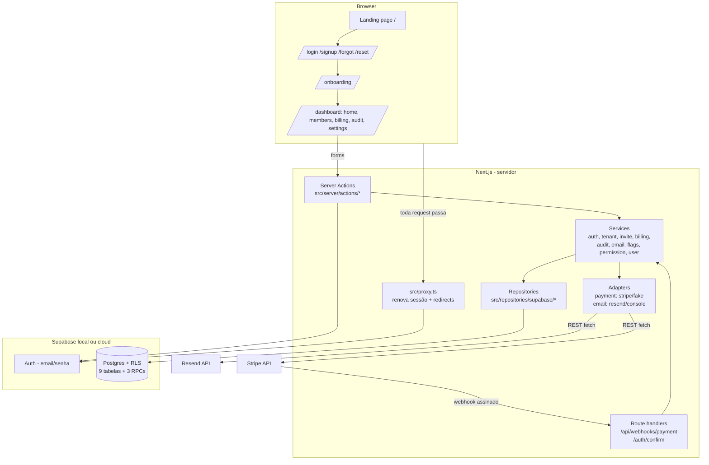

# Documentação Técnica — Starter Kit SaaS Multi-Tenant

> Documento de handover: escrito para um desenvolvedor que nunca viu este código.
> Última atualização: 2026-07-06. Reflete o código real do repositório neste commit —
> se você mudar o código, atualize este arquivo.

---

## 1. Visão geral

### O que este sistema é

Este projeto **não é um produto final** — é um **template (starter kit) para construir SaaS multi-tenant**. "Multi-tenant" significa: várias empresas usam a mesma aplicação e o mesmo banco de dados, mas **uma empresa jamais enxerga os dados da outra**. A ideia é clonar este repositório para cada novo produto e trocar apenas nome, cores, planos comerciais e as entidades do domínio (ex.: pacientes, imóveis, pedidos), aproveitando toda a fundação já pronta.

### O que já funciona, em linguagem simples

- Uma pessoa cria uma conta com email e senha.
- No primeiro acesso ela cria uma **empresa** e vira **owner** (dona) dela.
- Ela convida outras pessoas por email para a empresa, com papel `admin` ou `member`.
- Cada usuário pode pertencer a várias empresas e alternar entre elas no topo da tela.
- A empresa tem um **plano** (Free/Pro/Enterprise) que limita funcionalidades.
- Ações importantes (convites, mudanças de papel) ficam registradas numa **auditoria**.
- Tudo isso com telas responsivas (desktop e celular) e tema claro/escuro.

### Principais fluxos

1. **Cadastro e onboarding**
   `usuário preenche /signup` → server action valida (Zod) e cria usuário no Supabase Auth → trigger no banco cria a linha em `profiles` → usuário é redirecionado para `/onboarding` → cria a primeira empresa (RPC `create_company`, que cria empresa + membership `owner` numa transação) → cai no `/dashboard`.

2. **Login e proteção de rotas**
   `usuário preenche /login` → server action aplica rate limit por email e autentica → sessão gravada em cookies → `src/proxy.ts` (o "middleware" do Next 16) renova a sessão a cada request e redireciona: sem sessão em `/dashboard/*` → vai para `/login?next=...`; com sessão em `/login` → vai para `/dashboard`.

3. **Convite de membro**
   Admin/owner abre `/dashboard/members` → preenche email + papel → server action revalida o papel do autor, aplica rate limit, insere em `company_invites` (token UUID, expira em 7 dias) → email com link `/invites/accept?token=...` é enviado pelo `EmailProvider` (em dev, é impresso no terminal) → convidado loga/cria conta e aceita → RPC `accept_company_invite` valida token/email/expiração e cria a membership.

4. **Troca de empresa ativa**
   Usuário clica no seletor no header → server action **revalida que ele é membro** da empresa escolhida → grava o id num cookie httpOnly → dashboard recarrega mostrando os dados da nova empresa. O cookie é só preferência de UI: a cada request a membership é reconferida (um cookie forjado não dá acesso a nada, a RLS bloqueia).

5. **Assinatura de plano (billing)**
   Owner abre `/dashboard/billing` → escolhe um plano → com gateway **fake** (dev): a ativação simula o webhook e grava a assinatura direto; com **stripe**: cria uma sessão de checkout via API REST e redireciona → o Stripe chama `POST /api/webhooks/payment` → o adapter **verifica a assinatura HMAC** do webhook, normaliza o evento para um formato interno e o `billingService` atualiza a tabela `subscriptions`. A checagem de limites em runtime é sempre `billingService.canAccessFeature(companyId, featureKey)`.

---

## 2. Arquitetura e stack

### Tecnologias e por que estão aqui

| Tecnologia | Versão | Por quê |
|---|---|---|
| **Next.js (App Router)** | 16.2.10 | Framework React full-stack: páginas server-rendered, server actions (mutações sem API manual), route handlers (webhook). **Atenção:** no Next 16 o middleware chama-se `proxy.ts`, e os docs locais em `node_modules/next/dist/docs/` devem ser consultados (há breaking changes vs. versões antigas). |
| **React** | 19.2 | UI. Usa `useActionState` para forms com server actions. |
| **TypeScript** | 5.x | Tipagem estática em todo o código. |
| **Tailwind CSS** | 4.x | Estilização utilitária; tokens de tema via CSS variables. |
| **shadcn/ui** | — | Componentes de UI copiados para dentro do repo (`src/components/ui`). **Atenção:** a versão instalada usa **Base UI** (`@base-ui/react`), não Radix — a API difere (`render={...}` em vez de `asChild`, `nativeButton={false}` para links, `DropdownMenuLabel` exige `DropdownMenuGroup`). |
| **Supabase** | supabase-js 2.x, ssr 0.12 | Auth (email/senha), Postgres (dados) e RLS (isolamento multi-tenant). `@supabase/ssr` gerencia a sessão em cookies para server components/actions/proxy. |
| **Zod** | 4.x | Validação de dados no client E no server. **Atenção:** Zod 4 usa `z.email()`, `z.uuid()`, `z.url()` (não `z.string().email()` etc.). |
| **Vitest** | 4.x | Testes unitários dos services. |
| **Playwright** | 1.61 | Testes end-to-end no navegador. |
| **next-themes** | 0.4 | Alternância dark/light via classe no `<html>`. |
| **lucide-react** | — | Ícones. |
| **server-only** | — | Pacote que **quebra o build** se código de servidor (ex.: chave service_role) for importado por código de client. É uma trava de segurança. |
| **GitHub Actions** | — | CI: lint, typecheck, testes, build e testes de RLS. |

**Sem SDKs de Stripe/Resend**: os dois provedores são chamados via `fetch` REST puro dentro dos adapters, de propósito — menos dependências e o provedor fica 100% atrás da interface.

### A regra arquitetural inegociável

```
componentes React → hooks → services → repositories/adapters → Supabase | API externa | Gateway
```

- **Componente nunca importa `@supabase/supabase-js`.** Se você se pegar fazendo isso, pare e crie um service/repository.
- **Services** (`src/services`) têm as regras de negócio, sem I/O direto: recebem o repositório por injeção (por isso são testáveis com fakes em memória).
- **Repositories** (`src/repositories/supabase`) fazem as queries. Recebem o client Supabase de fora — quem decide se é o client anônimo (RLS ativa) ou o service_role (ignora RLS) é o chamador.
- **Adapters** (`src/adapters/payment`, `src/adapters/email`) isolam provedores externos atrás de interfaces (`PaymentGateway`, `EmailProvider`).

### Diagrama



### Mapa de pastas

```
src/
  app/                      # Rotas (App Router)
    page.tsx                #   Landing page
    (auth)/                 #   login, signup, forgot-password, reset-password
    onboarding/             #   criação da primeira empresa
    invites/accept/         #   aceite de convite por token
    dashboard/              #   área logada (layout valida empresa ativa)
      members/ billing/ audit/ settings/
    api/webhooks/payment/   #   webhook do gateway de pagamento
    auth/confirm/           #   troca token de email por sessão
  components/
    ui/                     #   shadcn/ui (Base UI) — 16 componentes
    app-shell/              #   sidebar, header, breadcrumbs, switcher, user-menu
  features/                 #   componentes com estado por domínio (auth, companies, billing)
  services/                 #   regras de negócio + testes unitários
  repositories/supabase/    #   implementação concreta das queries
  adapters/payment/ email/  #   provedores externos atrás de interface
  providers/                #   ThemeProvider, TenantProvider (empresa ativa)
  server/                   #   código exclusivo de servidor (server-only)
    actions/                #   server actions (auth, tenant, billing, user)
    supabase-server.ts      #   client anon + sessão em cookies
    supabase-admin.ts       #   client service_role (NUNCA no client)
    tenant.ts               #   empresa ativa (cookie revalidado)
    rateLimit.ts            #   rate limiter (in-memory)
  lib/errors/               #   formato único de erro (AppError)
  types/                    #   types do schema e do domínio
  config/                   #   brand.ts (identidade) e env.ts (validação de env)
  proxy.ts                  #   middleware do Next 16
supabase/
  migrations/               #   schema versionado (9 arquivos)
  tests/rls_test.sql        #   testes de isolamento multi-tenant
e2e/                        #   specs Playwright
scripts/test-rls.sh         #   roda o teste SQL no container Docker
.github/workflows/ci.yml    #   pipeline de CI
```

---

## 3. Status real de cada funcionalidade

Legenda: ✅ pronto e testado · ⚠️ implementado mas não testado de verdade ou com limitação conhecida · ❌ não existe (só planejado)

| Funcionalidade | Status | Detalhes |
|---|---|---|
| Signup / login / logout | ✅ | Coberto por E2E no navegador (Playwright) contra Supabase local. |
| Proteção de rotas (proxy) | ✅ | E2E confirma redirect de `/dashboard` sem sessão. |
| Recuperação de senha | ⚠️ | Código completo (rate limit, link por email, `/auth/confirm`, `/reset-password`), mas **o fluxo nunca foi exercitado ponta a ponta** — em dev o email é impresso no terminal e ninguém clicou no link para validar. Testar antes de produção. |
| Onboarding (1ª empresa) | ✅ | E2E cobre. RPC `create_company` também testada nos testes SQL. |
| Multi-tenant / RLS | ✅ | O ponto mais forte do projeto: `supabase/tests/rls_test.sql` prova em banco real que leitura e escrita cross-tenant falham. Roda local e no CI. |
| Troca de empresa ativa | ✅ | E2E cobre, inclusive persistência do cookie após reload. |
| Convites (criar/revogar) | ✅ | E2E cobre criar e revogar. |
| Aceite de convite | ⚠️ | RPC testada no SQL (recusa convite de outro email), página `/invites/accept` existe, mas **o fluxo completo no navegador (2º usuário clicando no link) não tem teste E2E**. |
| Gestão de membros (papel/remoção) | ⚠️ | Regras de permissão têm testes unitários; a UI funciona manualmente; não há E2E específico de mudar papel/remover. |
| Billing com gateway **fake** | ✅ | Ciclo completo funciona em dev (ativar plano, cancelar, refletir no dashboard). |
| Billing por seat | ⚠️ | Regras testadas por unit tests (cálculo de extras, sync condicionado a assinatura ativa, ilimitado); convites/remoções ressincronizam o gateway; UI mostra "inclusos + extras = R$/mês". **Limitações:** `syncExtraSeats` do Stripe (subscription items) nunca rodou contra a API real; `GATEWAY_EXTRA_SEAT_PRICE_ID` é placeholder; falha no sync só loga (sem retry/reconciliação agendada). |
| Billing com **Stripe real** | ⚠️ | Adapter completo (checkout, cancelamento, portal, webhook com verificação HMAC testada por unit tests), **mas nunca foi conectado à API real do Stripe**. Falta: criar produtos/preços no Stripe, mapear `gatewayPriceId` (hoje é o placeholder `price_${planId}` em `src/server/actions/billing.ts`), configurar chaves e testar webhook de verdade. |
| Email com provider **console** | ✅ | Em dev, o email aparece no terminal do `npm run dev`. |
| Email com **Resend real** | ⚠️ | Adapter completo via REST, mas nunca testado com conta/chave real nem domínio verificado. |
| Auditoria | ✅ | Sanitização com testes unitários; imutabilidade testada no SQL; UI lista eventos. Cobre: convite/revogação, mudança de papel (`member.role_changed`, com papel anterior), remoção (`member.removed`), saída (`member.left`), edição da empresa (`company.updated`), billing (`subscription.checkout_started/activated/canceled`) e eventos de webhook (sistema, `user_id` null). Leituras (acesso a dados) não são auditadas — decisão de escopo. |
| Feature flags | ⚠️ | `featureFlagService` testado por unit tests, **mas nada na UI usa flags ainda** — está pronto para ser consumido, não consumido. |
| Rate limiting | ⚠️ | Dois stores atrás da mesma interface, escolhidos por `RATE_LIMIT_STORE`: `memory` (default, janela deslizante, só vale por instância) e `redis` (Upstash via REST, janela fixa, vale entre instâncias). O adapter Upstash tem unit tests com fetch mockado (bloqueio, janela, fail-open), **mas nunca rodou contra uma conta Upstash real**. Decisão consciente: se o Redis cair, o limiter falha ABERTO (permite e loga). |
| UI responsiva / tema | ✅/⚠️ | Sidebar rail/drawer e tabelas→cards implementados; tema dark/light ok. **Não foi testado em celular físico** (só viewport de navegador). |
| Perfil do usuário (nome) | ✅ | Editável em `/dashboard/settings`. |
| Upload de avatar | ✅ | Adapter `StorageProvider` (Supabase Storage) + bucket `avatars` com policies por pasta do usuário (testadas no SQL de RLS) + validação de tipo/tamanho no client e no server (unit tests, incl. rejeição de SVG) + UI em settings e avatar no menu. **Validado manualmente em 2026-07-06**: SVG recusado, PNG >2MB recusado, PNG válido aceito e refletido no perfil e no header. |
| CI (GitHub Actions) | ⚠️ | Workflow completo (lint, typecheck, unit, build, RLS), **mas nunca rodou** — o repositório não tem remote no GitHub. Vai rodar no primeiro push. |
| Deploy / produção | ❌ | Não existe nada de deploy. Ver seção 6. |
| Upload de arquivos genérico | ⚠️ | A interface `StorageProvider` e o adapter Supabase existem (usados pelo avatar); uploads de outros tipos de arquivo (documentos etc.) exigem novo bucket + policies + validações próprias. |
| Notificações (WhatsApp/SMS/push) | ⚠️ | Interface `NotificationProvider` + adapter `console` (dev, testado) + factory por `NOTIFICATION_PROVIDER`. **Nenhum provedor real implementado, e nenhum service dispara notificação ainda** — é ponto de extensão documentado (passo a passo em `src/adapters/notification/NotificationProvider.ts`), não funcionalidade. |
| Transferência de ownership | ❌ | Bloqueada de propósito (`changeMemberRole` recusa promover a `owner`). Owner também não pode sair da empresa. |
| Termos de uso + LGPD | ⚠️ | Versões de termos (`terms_versions`, uma vigente), aceites append-only com IP/user-agent (`terms_acceptances`) e consentimentos por finalidade (`user_consents`, grant/revoke como eventos; email opcional separado do aceite). Gate no onboarding (checkbox + validação no server) e no layout do dashboard (versão nova força reaceite em `/accept-terms`); página pública `/terms`. Coberto por unit tests (incl. reaceite ao publicar versão nova), RLS SQL (aceite forjado bloqueado, append-only) e E2E do gate no onboarding. **Limitações:** o texto da versão 1 é PLACEHOLDER sem valor jurídico (troque por texto revisado juridicamente via migration); o fluxo de reaceite (versão nova → redirect `/accept-terms`) é testado por unit test, não por E2E; não há UI para revogar o consentimento de email depois (só o evento no banco). |
| Exclusão de empresa / conta | ❌ | Não implementado (nem soft delete de empresa pela UI). |
| Permissões granulares | ⚠️ | Estrutura pronta, papéis novos NÃO criados: o banco guarda papel como `text` com FK para `roles.code` (papel novo = INSERT) e o `permissionService` virou registro de capabilities + nível hierárquico (`defineRole` como ponto de extensão; papel desconhecido nega tudo). Comportamento dos 3 papéis fixos preservado e testado. **Atenção:** as policies de RLS (`is_company_admin`) citam `('owner','admin')` — papel customizado que precise de poder de admin no BANCO exige ajustar as policies também. |
| Componentes de gráfico | ✅ | `LineChartCard`, `BarChartCard` e `DonutChartCard` (`src/components/charts`, base comum em `chart-base.tsx`) sobre Recharts, lendo os tokens `--chart-1..5` (paleta validada por script para light/dark, daltonismo e contraste). Regras embutidas: máx. 5 séries/fatias (donut agrega excedente em "Outros"), cor fixa por posição, eixo único, legenda só com 2+ séries, tooltip padrão, sr-only. **Validado visualmente em 2026-07-06** (cores, dark/light, hover, responsividade; correções da validação: função não serializável em Server Component → prop `valueFormat`, e eixo Y dinâmico para não cortar "R$"). Exemplos de uso com dados fake: seção "Exemplos de gráficos" no dashboard (`src/app/dashboard/page.tsx`). Barras e donut seguiram o mesmo padrão, mas foram conferidos só pelo dev — vale um olhar visual. |
| i18n | ❌ | Textos hardcoded em português. |

**Números de teste (última execução local, 2026-07-04):** 49 testes unitários ✅ · testes SQL de RLS ✅ · 4 specs E2E ✅ · build de produção ✅.

---

## 4. Onde os dados ficam

### Visão geral

Toda persistência é no **Postgres do Supabase**. Não há outro banco, cache, fila ou arquivo local de dados. Estados efêmeros: cookies (sessão, empresa ativa, sidebar colapsada) e o rate limiter em memória do processo Node.

Em dev, o Postgres roda num container Docker (`supabase_db_starterkit_front`) com volume persistente — **os dados sobrevivem a reinícios da máquina**; só `npx supabase db reset` apaga (e reaplica as migrations).

### Tabelas (schema `public`)

Todas as tabelas de negócio têm `company_id` (a qual empresa a linha pertence) e `deleted_at` (soft delete: em vez de apagar, marca-se a data — as queries filtram `deleted_at is null`). Todas têm RLS ativa; um usuário só acessa linhas de empresas onde tem membership ativa em `company_members`.

**`profiles`** — dados públicos do usuário (1:1 com `auth.users`, criada por trigger no signup)
| Campo | Significado |
|---|---|
| `id` | UUID, igual ao id do usuário no Supabase Auth |
| `full_name` | nome exibido |
| `avatar_url` | URL do avatar (coluna existe, upload não implementado) |
| `created_at` / `updated_at` | timestamps |

**`companies`** — as empresas (os "tenants")
| Campo | Significado |
|---|---|
| `id` | UUID |
| `name` | nome exibido |
| `slug` | identificador único em URL (ex.: `minha-empresa`) |
| `created_by` | usuário que criou |
| `deleted_at`, `created_at`, `updated_at` | — |

**`company_members`** — quem pertence a qual empresa (o coração do multi-tenant)
| Campo | Significado |
|---|---|
| `company_id` / `user_id` | o vínculo (único por par, entre linhas ativas) |
| `role` | `owner` \| `admin` \| `member` |
| `invited_by` | quem convidou (nullable) |
| `deleted_at` | remover membro = soft delete aqui |

**`company_invites`** — convites pendentes
| Campo | Significado |
|---|---|
| `email` | email convidado |
| `role` | papel que a pessoa terá (`admin`/`member`; owner não é convidável) |
| `token` | UUID secreto do link de aceite |
| `status` | `pending` \| `accepted` \| `revoked` \| `expired` |
| `expires_at` | 7 dias após criação |
| `invited_by`, `company_id`, `deleted_at`… | — |

**`roles`** — catálogo dos 3 papéis (tabela de referência, leitura para autenticados)

**`plans`** — catálogo de planos (global, não tem `company_id`; gerido por migration)
| Campo | Significado |
|---|---|
| `code` | `free` \| `pro` \| `enterprise` (único) |
| `name`, `price_cents`, `currency`, `billing_interval` | exibição/cobrança |
| `features` | JSONB com limites/flags, ex.: `{"max_members": 15, "api_access": true}` — é daqui que `canAccessFeature` lê; `max_members` também é a franquia de seats |
| `extra_seat_price_cents` | preço mensal por membro além de `max_members` (0 = não vende extra; free é 0) |
| `is_active` | plano ofertável ou não |

**`subscriptions`** — assinatura da empresa (no máx. 1 ativa por empresa)
| Campo | Significado |
|---|---|
| `company_id`, `plan_id` | quem assina o quê |
| `status` | `trialing` \| `active` \| `past_due` \| `canceled` \| `incomplete` (acesso é mantido em `trialing`/`active`/`past_due`) |
| `external_subscription_id` / `external_customer_id` | ids no gateway — **neutros de propósito** (nada de `stripe_*` no schema) |
| `current_period_start/end`, `cancel_at_period_end` | ciclo de cobrança |

**`audit_logs`** — trilha de auditoria (append-only: client não tem GRANT de UPDATE/DELETE)
| Campo | Significado |
|---|---|
| `user_id` | quem fez (null = evento de sistema, ex.: webhook) |
| `action` | convenção `entidade.verbo` (ex.: `member.invited`) |
| `entity_type` / `entity_id` | sobre o quê |
| `metadata` | JSONB extra — **sanitizado**: chaves como password/token/card são removidas antes de gravar |

**`settings`** — chave/valor por empresa (JSONB). Usada pelos feature flags: `feature:<key>` (override da empresa) e `feature:<key>:user:<userId>` (override por usuário).

**`terms_versions`** — versões dos Termos de Uso (globais, como `plans`; escrita só por migration/service_role). Índice único parcial garante uma única `is_current`.

**`terms_acceptances`** — prova de aceite por usuário e versão (`ip_address`, `user_agent`, `accepted_at`). Append-only: sem GRANT de UPDATE/DELETE. Único por (user, versão).

**`user_consents`** — log de eventos de consentimento LGPD por finalidade (`consent_type`, hoje só `email_communications`; `granted` true/false). O estado atual é o evento mais recente. Append-only; revogar = inserir evento negativo. Tabelas de usuário (sem `company_id`), como `profiles`.

### Storage (arquivos)

Bucket `avatars` (público para leitura; 2MB; só JPG/PNG/WebP — limites também no bucket). Path: `<user_id>/avatar.<ext>`. Policies em `storage.objects` garantem que cada usuário só escreve na própria pasta (testado em `rls_test.sql`). A URL pública fica em `profiles.avatar_url` com query de cache-busting.

### Funções no banco (RPCs, `security definer`)

- `create_company(p_name, p_slug)` — cria empresa + membership owner atomicamente.
- `accept_company_invite(p_token)` — valida token/expiração/email do logado e cria a membership.
- `leave_company(p_company_id)` — sai da empresa (owner é bloqueado na aplicação).
- Trigger `handle_new_user` — cria o `profile` quando um usuário se cadastra.

### Detalhe crítico de segurança do schema

RLS **não basta** neste setup: tabelas criadas pela role `postgres` não dão privilégio automático a `anon`/`authenticated`. Cada migration faz `GRANT` explícito do mínimo necessário (ex.: `audit_logs` só tem SELECT e INSERT — por isso é imutável). **Ao criar tabela nova, copie o padrão: RLS + policies + GRANTs na mesma migration.**

### Segredos e variáveis de ambiente

Ficam em `.env.local` (ignorado pelo git; `.env.example` é o modelo commitado). Validação em `src/config/env.ts` — variável faltando derruba o boot com erro claro.

| Variável | Exposta ao browser? | Para quê |
|---|---|---|
| `NEXT_PUBLIC_SUPABASE_URL` | sim | URL do Supabase (local: `http://127.0.0.1:54321`) |
| `NEXT_PUBLIC_SUPABASE_ANON_KEY` | sim | chave anônima — **segura de expor**, a RLS limita tudo |
| `NEXT_PUBLIC_BACKEND_PROVIDER` | sim | `supabase` (default) ou `api` (previsto para backend próprio futuro; hoje só `supabase` tem implementação) |
| `SUPABASE_SERVICE_ROLE_KEY` | **NUNCA** | chave que **ignora RLS**. Só usada em `src/server/` (webhook e simulação fake). O pacote `server-only` impede import no client. |
| `APP_URL` | não | URL pública, usada nos links dos emails (default `http://localhost:3000`) |
| `PAYMENT_GATEWAY` | não | `fake` (default) ou `stripe` |
| `STRIPE_SECRET_KEY` / `STRIPE_WEBHOOK_SECRET` | não | só exigidas se `PAYMENT_GATEWAY=stripe` |
| `EMAIL_PROVIDER` | não | `console` (default) ou `resend` |
| `RESEND_API_KEY` / `EMAIL_FROM` | não | só exigidas se `EMAIL_PROVIDER=resend` |
| `NOTIFICATION_PROVIDER` | não | `console` (único implementado; imprime no terminal) |
| `RATE_LIMIT_STORE` | não | `memory` (default) ou `redis` (Upstash, para 2+ instâncias/serverless) |
| `UPSTASH_REDIS_REST_URL` / `UPSTASH_REDIS_REST_TOKEN` | não | só exigidas se `RATE_LIMIT_STORE=redis` (Console Upstash > REST API) |

**Estado atual do `.env.local` desta máquina:** aponta para o Supabase **local** (as chaves são as demo keys públicas do CLI, não são segredo). As chaves do projeto remoto (`fuxihgdjrhrwwqnymlau.supabase.co`) estão comentadas no fim do arquivo. **O projeto remoto ainda NÃO tem as migrations aplicadas** — não funciona até rodar `npx supabase db push`.

---

## 5. Como rodar do zero

### Pré-requisitos

1. **Node.js 22+** — https://nodejs.org
2. **Docker Desktop** — https://docker.com (o Supabase local roda em containers). Precisa estar **aberto** antes de subir o banco.
3. **Git**
4. Nenhuma conta externa é necessária para desenvolvimento (Stripe/Resend só para produção).

### Passo a passo

```bash
# 1. Clonar e instalar
git clone <url-do-repo> meu-saas
cd meu-saas
npm install

# 2. Subir o Supabase local (Docker aberto!)
npx supabase start
# Primeira vez demora (baixa ~2GB de imagens). Ao final imprime um JSON
# com API_URL, ANON_KEY, SERVICE_ROLE_KEY etc. As migrations (schema + RLS
# + seed de planos) são aplicadas automaticamente.

# 3. Criar o .env.local
cp .env.example .env.local
```

Edite o `.env.local` preenchendo com os valores que o passo 2 imprimiu:

```bash
NEXT_PUBLIC_SUPABASE_URL=http://127.0.0.1:54321        # = API_URL
NEXT_PUBLIC_SUPABASE_ANON_KEY=<ANON_KEY do passo 2>
NEXT_PUBLIC_BACKEND_PROVIDER=supabase
SUPABASE_SERVICE_ROLE_KEY=<SERVICE_ROLE_KEY do passo 2>
APP_URL=http://localhost:3000
PAYMENT_GATEWAY=fake      # billing simulado, sem conta Stripe
EMAIL_PROVIDER=console    # emails impressos no terminal, sem conta Resend
```

```bash
# 4. Rodar o app
npm run dev
# http://localhost:3000 → crie uma conta em /signup (não pede confirmação
# de email em dev) → crie sua empresa → dashboard.

# 5. Rodar os testes (opcional, mas recomendado para conferir o setup)
npm run test        # unitários (não precisa de banco)
npm run test:rls    # isolamento multi-tenant (precisa do supabase local de pé)
npx playwright install chromium   # 1ª vez: baixa o navegador de teste
npm run test:e2e    # fluxos no navegador (sobe o app sozinho)
```

### Comandos do dia a dia

| Comando | O que faz |
|---|---|
| `npm run dev` | servidor de desenvolvimento |
| `npm run build` / `npm start` | build e servidor de produção |
| `npm run lint` / `npm run typecheck` | qualidade estática |
| `npm run test` / `test:watch` / `test:rls` / `test:e2e` | testes |
| `npx supabase start` / `stop` | sobe/para o banco local (dados persistem) |
| `npx supabase db reset` | **APAGA** o banco local e reaplica migrations |
| `npx supabase migration new <nome>` | cria arquivo de migration novo |

### Problemas comuns

- **"failed to connect to docker"** → Docker Desktop não está aberto.
- **Erro `PGRST205: Could not find the table ...`** → o app está apontando para um Supabase sem as migrations (tipicamente o remoto). Confira o `.env.local`.
- **Login do usuário de dev sumiu** → os dados locais não somem sozinhos; verifique se o `.env.local` não está apontando para outro banco. Usuário demo desta máquina: `demo@demo.com` / `demo12345` (existe só no banco local).
- **Porta 3000 ocupada** → há outro `next dev` rodando; o erro indica o PID para matar.

---

## 6. Como rodar em produção / deploy

**Hoje não existe deploy configurado.** O que segue é o caminho recomendado, não o estado atual.

### Caminho recomendado (Vercel + Supabase cloud)

1. **Supabase cloud**: criar projeto (ou usar o remoto já existente `fuxihgdjrhrwwqnymlau`), rodar `npx supabase link --project-ref <ref>` e `npx supabase db push` para aplicar as migrations. Conferir no painel que as tabelas e policies existem.
2. **Auth em produção**: no painel do Supabase, configurar Site URL (= `APP_URL`) e redirect URLs (`https://seu-dominio.com/auth/confirm`). Decidir se exige confirmação de email (local não exige; produção deveria).
3. **Vercel**: importar o repo, configurar as env vars da seção 4 (com as chaves do projeto cloud e `APP_URL` real). O `npm run build` já passa limpo.
4. **Stripe** (quando for cobrar de verdade): criar produtos/preços, trocar o placeholder `gatewayPriceId` em `src/server/actions/billing.ts` por um mapeamento real plano→price, configurar `PAYMENT_GATEWAY=stripe` + chaves, registrar o webhook `https://seu-dominio.com/api/webhooks/payment` e testar com o Stripe CLI.
5. **Resend**: verificar domínio, configurar `EMAIL_PROVIDER=resend` + `RESEND_API_KEY` + `EMAIL_FROM`.
6. **GitHub**: no primeiro push o CI passa a rodar (lint, typecheck, unit, build, RLS). Proteger a branch `main` exigindo o CI verde.

### Diferenças dev × produção

| Aspecto | Dev (hoje) | Produção (necessário) |
|---|---|---|
| Banco | Supabase local (Docker), demo keys públicas | Supabase cloud, chaves reais secretas |
| Billing | gateway `fake` (botão "Ativar (dev)" simula webhook) | `stripe` — a action fake **se recusa a rodar** se o gateway não for fake |
| Email | impresso no terminal | Resend com domínio verificado |
| Confirmação de email | desligada | recomendável ligar |
| Rate limit | in-memory (ok p/ 1 instância) | trocar store (Redis/Upstash) se houver 2+ instâncias |
| HTTPS | não | obrigatório (Vercel dá de graça) |

---

## 7. Pontos de atenção e dívida técnica

Em ordem de importância — **revisar antes de expor a clientes reais**:

1. **Stripe e Resend nunca foram testados contra as APIs reais.** O código está correto no papel (assinatura de webhook tem teste unitário com HMAC real), mas integração de pagamento sempre revela surpresas. Reserve tempo para testar com Stripe CLI antes do primeiro cliente pagante. Placeholders que **não funcionarão no Stripe real**: `gatewayPriceId = "price_" + planId` (checkout) e `GATEWAY_EXTRA_SEAT_PRICE_ID = "price_extra_seat"` (seat extra, em `src/server/billing.ts`) — ambos precisam ser mapeados para prices criados no painel do Stripe. O sync de seats após convite/remoção é *best-effort*: se falhar, só loga — não há job de reconciliação periódica.

2. **Recuperação de senha sem teste ponta a ponta.** O fluxo do link de email → `/auth/confirm` → `/reset-password` nunca foi clicado de verdade. Teste manual obrigatório.

3. **Rate limiter em produção exige `RATE_LIMIT_STORE=redis`.** O default `memory` é quase inócuo em serverless (cada instância tem seu contador). O adapter Upstash está pronto e testado com mock, mas **nunca validado contra uma conta Upstash real** — teste manual obrigatório ao configurar produção. Se o Redis ficar fora, o limiter falha aberto (loga e permite) — decisão deliberada para o login não cair junto; reavalie se seu threat model exigir fail-closed.

4. **CI nunca executou.** O workflow está escrito mas o repo não tem remote. Primeiro push pode revelar ajustes (ex.: versão do supabase CLI na action).

5. **Auditoria cobre escrita, não leitura.** Todas as ações sensíveis de escrita registram evento (fase 3), mas acesso de leitura a dados não gera trilha — se o produto exigir (ex.: prontuário médico/LGPD), adicionar `recordAudit` nas leituras críticas. Nota: a falha ao gravar auditoria PROPAGA e desfaz a action (postura deliberada: trilha furada é pior que operação recusada).

6. **Sessão do webhook usa service_role.** Correto (webhook não tem usuário), mas significa que um bug no adapter de pagamento escreve no banco sem RLS. A verificação HMAC é a única barreira — mantenha-a intocada e nunca processe evento não verificado.

7. **Cookie de sidebar e `active-company` sem `secure` flag explícita.** Em produção com HTTPS o Next/Vercel resolve na prática, mas vale endurecer (`secure: true` em `src/server/actions/tenant.ts`).

8. **`profiles.avatar_url` e `NEXT_PUBLIC_BACKEND_PROVIDER=api` são estrutura ociosa.** Colunas/opções previstas sem implementação por trás. Não é bug, mas pode confundir: o provider `api` não tem repositório implementado — só `supabase` funciona.

9. **Paginação implementada em membros e auditoria** (offset via `?page=`, 20 por página, links sem JS, `normalizePageParams` defensivo com unit tests). Convites pendentes seguem sem paginação (volume tende a ser pequeno); listas futuras de domínio devem copiar o padrão `Paginated<T>`.

10. **Testado só em resize de navegador, não em celular físico** (checklist do plano pede aparelho real).

11. **Encoding no Windows:** inserir texto acentuado via `curl` no Git Bash corrompe UTF-8 (aconteceu com o usuário demo, já corrigido). Para seeds com acento use migrations/SQL com escapes `U&'\00E1'` ou scripts Node.

12. **O texto dos Termos de Uso é PLACEHOLDER.** A versão 1 em `terms_versions` diz isso no próprio corpo: não tem valor jurídico e DEVE ser substituída (via migration: insert de versão nova com `is_current`, desmarcando a anterior) por texto revisado por profissional jurídico antes de qualquer cliente real. Publicar a versão nova força reaceite de todos automaticamente.

13. **Não use o painel do Supabase para mudar schema.** Toda mudança via migration versionada — o isolamento multi-tenant depende de policies+GRANTs que o painel não vai criar para você.

### O que está sólido (para não mexer sem motivo)

- O **isolamento multi-tenant** é testado por SQL executável (`npm run test:rls`) — se você mudar policies, esse teste te protege.
- A **fronteira client/servidor** (`server-only` no client admin) falha em build, não em runtime.
- O **formato único de erro** (`AppError` → `toPublicError`) garante que stack traces não vazam para o usuário.

---

## 8. Glossário

| Termo | Significado |
|---|---|
| **SaaS** | Software as a Service — software vendido por assinatura, acessado pelo navegador. |
| **Multi-tenant** | Vários clientes ("tenants" = empresas) na mesma aplicação e banco, com dados isolados entre si. |
| **Tenant** | Uma empresa cliente. Neste projeto, uma linha em `companies`. |
| **RLS (Row Level Security)** | Recurso do Postgres que filtra **linhas** por usuário: mesmo que o código tente ler dados de outra empresa, o banco não retorna. É a última e mais importante barreira de segurança. |
| **Policy** | A regra de RLS em si (ex.: "SELECT em `settings` só se o usuário for membro da empresa da linha"). |
| **GRANT** | Permissão de banco mais básica que a RLS (pode usar SELECT/INSERT/UPDATE na tabela?). Aqui, RLS e GRANT trabalham juntos. |
| **Migration** | Arquivo SQL versionado que altera o schema do banco. Rodam em ordem pelo nome. Nunca se edita o banco "na mão". |
| **RPC** | Função que roda dentro do Postgres, chamada pela aplicação (ex.: `create_company`). `security definer` = roda com privilégios do dono da função, ignorando RLS — por isso valida tudo internamente. |
| **Soft delete** | Marcar `deleted_at` em vez de apagar a linha. Permite recuperação e auditoria. |
| **Supabase** | Plataforma que empacota Postgres + autenticação + APIs. Tem versão local (Docker) e cloud. |
| **anon key / service_role key** | Chaves do Supabase: a `anon` respeita RLS (pode ir ao browser); a `service_role` ignora RLS (**jamais** sai do servidor). |
| **App Router / Server Component** | Modelo do Next.js onde páginas renderizam no servidor por padrão e podem buscar dados direto (sem API intermediária). |
| **Server Action** | Função que roda no servidor mas é chamada por um `<form>` do React — é como os formulários enviam dados aqui, sem endpoints REST manuais. |
| **Proxy (Next 16)** | Novo nome do "middleware": código que roda antes de toda request (aqui: renova sessão e redireciona). |
| **Webhook** | O provedor externo (Stripe) chama uma URL nossa para avisar de eventos (pagamento aprovado etc.). Verificamos a assinatura HMAC para garantir que veio dele. |
| **HMAC** | Assinatura criptográfica com chave secreta — prova que o webhook veio do Stripe e não foi adulterado. |
| **Rate limit** | Limite de tentativas por janela de tempo (ex.: 10 logins/min por email) contra força bruta e abuso. |
| **Zod** | Biblioteca que valida dados em runtime (ex.: "isto é um email?"). Usada no client e no server. |
| **shadcn/ui / Base UI** | Kit de componentes copiados para o repo (você é dono do código). A base de acessibilidade é a lib Base UI. |
| **Adapter** | Camada que traduz um serviço externo (Stripe, Resend) para uma interface nossa — trocar de fornecedor = escrever outro adapter. |
| **Repository** | Camada que fala com o banco. Services pedem "liste membros"; o repository sabe o SQL/query. |
| **Service** | Camada com as regras de negócio ("admin não remove admin"). Não sabe de UI nem de banco. |
| **Feature flag** | Liga/desliga de funcionalidade por plano/empresa/usuário sem deploy. |
| **E2E (end-to-end)** | Teste que abre um navegador de verdade e usa o sistema como um usuário. |
| **CI** | Integração contínua: testes rodam automaticamente a cada push/PR no GitHub. |
| **Seed** | Dados iniciais inseridos por migration (aqui: os 3 planos). |
| **Mojibake** | Texto com acentos corrompidos (`Usu�rio`) por erro de encoding. |

---

*Gerado a partir da análise do código real em 2026-07-06. Commits relevantes: schema+RLS (`7432883`), Fase 2 (`649fbc7`..`2b4b660`), UI/auth/tenant (`5478916`..`e986a6a`), testes (`f36ce22`, `51b8067`), fix Base UI (`81383ac`).*
